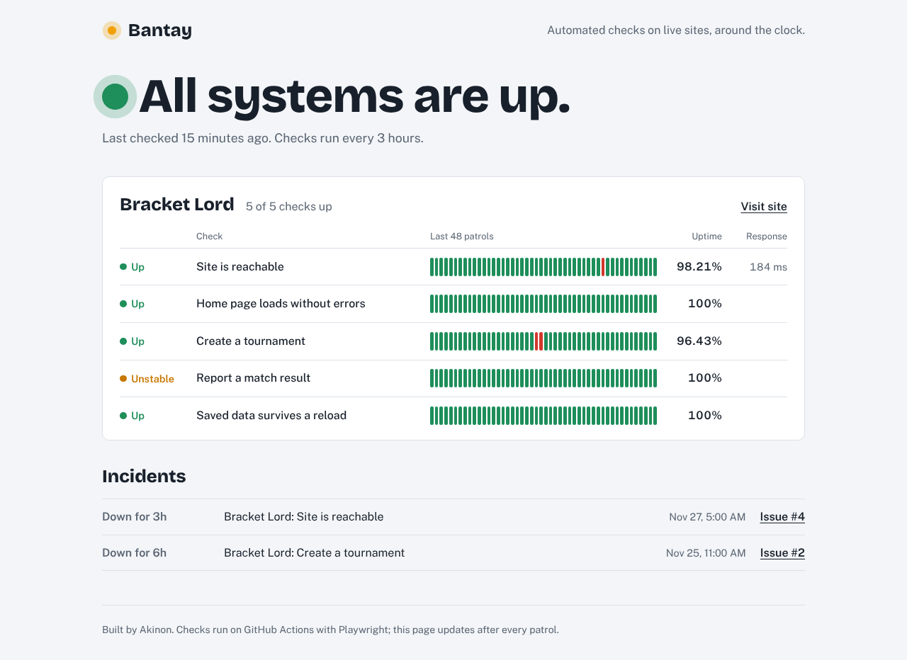

# Bantay 🔦

[](https://github.com/666yunoGASAI/bantay/actions/workflows/patrol.yml)
[](https://github.com/666yunoGASAI/bantay/actions/workflows/ci.yml)

**Automated monitoring for live web apps: Playwright checks on a schedule, GitHub issues and Discord alerts when something breaks, and a public status page.**

*Bantay* is Filipino for "guard" or "watch". Every 3 hours it walks through my deployed projects the way a real user would, and if something breaks, it files the bug report itself.

> **Status page:** _add your Vercel link here_



---

## What it does

```
 every 3 hours (GitHub Actions cron)
        │
        ▼
 Playwright checks run against the LIVE site ──► each check failed? retry once to rule out a blip
        │
        ▼
 compare with the last patrol
        │
        ├── newly broken  ──► open a GitHub issue (error, screenshot, repro steps, trace link)
        │                     + one Discord alert
        ├── still broken  ──► stay quiet (no alert spam)
        └── recovered     ──► comment "Recovered after 2h 15m", close the issue
                              + one Discord "back up" alert
        │
        ▼
 commit results ──► Vercel redeploys the status page (uptime, patrol history, incidents)
```

**Watched today:** [Bracket Lord](https://github.com/666yunoGASAI/bracket-lord). Five checks: the site is reachable, the home page loads without JavaScript errors, a tournament can be created, a match result can be reported, and saved data survives a reload.

## Skills on show

| Area | Where |
|---|---|
| **Workflow automation** | Scheduled GitHub Actions pipeline that tests, decides, reports, and publishes with no human in the loop ([patrol.yml](.github/workflows/patrol.yml)) |
| **Synthetic monitoring** | Playwright user journeys against production ([monitors/](monitors/)) |
| **API integration** | GitHub REST API (issues, comments, closing) and Discord webhooks ([src/github.ts](src/github.ts), [src/discord.ts](src/discord.ts)) |
| **Testing the automation itself** | 50 unit tests with fakes for GitHub and Discord, including outages of both ([tests/unit/](tests/unit/)) |
| **UI testing with mocked data** | 12 status-page scenarios using `page.route` network mocking and `page.clock` time control ([tests/status-page/](tests/status-page/)) |
| **CI/CD** | Separate CI pipeline tests every change; the patrol commits data with `[skip ci]` |

## Design decisions worth asking me about

**Alert on changes, not on states.** A site that's down for 6 hours produces *one* issue and *one* alert, not one every 3 hours. When it recovers, Bantay closes its own issue with how long the outage lasted. ([src/incidents.ts](src/incidents.ts))

**Confirm before alerting.** Each check gets one retry. A check that fails then passes counts as up but is shown as **Unstable** on the status page, so flakiness stays visible without anyone getting paged.

**"The site is down" vs. "the robot is broken".** If the patrol itself fails (the browser didn't install, Playwright crashed), Bantay records **nothing** and exits with an error, instead of reporting a fake outage. I found this the hard way: an early test run logged 4 false incidents because of a missing browser. ([src/results.ts](src/results.ts), `isInfrastructureError`)

**Never lose an incident.** If GitHub's API is down when a site breaks, the incident is still saved, and the issue is filed on the next patrol. A failing Discord webhook never blocks anything else. ([src/patrol.ts](src/patrol.ts))

**Watch the watcher.** If the status page notices the last patrol is more than twice as old as it should be, it warns that the monitor itself may be stuck. Results that look green but are 2 days old would be misleading.

**Chaos drill.** Run the Patrol workflow manually with *chaos* ticked and one check deliberately fails, so you can watch the whole loop (issue, screenshot, Discord alert, auto-close on the next normal run) without breaking the real site.

**Safe rendering.** Error messages come from outside systems, so the status page builds everything with `textContent`, never `innerHTML`. There's a test that feeds it an XSS payload to prove it.

## Test strategy

| Layer | Tool | Tests | What it proves |
|---|---|---|---|
| Unit | Vitest | 50 | Report parsing, uptime maths, incident decisions, issue and alert content, exact GitHub and Discord requests, and resilience when either is down |
| Status page | Playwright + mocked network + fixed clock | 12 scenarios × 2 viewports | Every state renders correctly: all up, down, unstable, stale patrol, first run, corrupted data, missing history, XSS attempt |
| Monitors | Playwright | 5 checks per patrol | The live site actually works for users, every 3 hours |

## Run it locally

Requires **Node.js 20+**.

```bash
npm install
npx playwright install chromium

npm run patrol              # run all checks once and update site/data (no issues or alerts without tokens)
npm run patrol:chaos        # same, with the chaos drill
npm run status-page         # view the status page at http://localhost:4300

npm run test:unit           # unit tests
npm run test:page           # status page tests
```

To patrol a local copy of a site instead of the live one:

```bash
# PowerShell
$env:BANTAY_URL_BRACKET_LORD="http://localhost:5173"; npm run patrol
```

**Setting it up on GitHub, Discord and Vercel:** see [docs/SETUP.md](docs/SETUP.md).

## Adding a site

1. Add it to [`bantay.config.ts`](bantay.config.ts).
2. Create `monitors/<site-id>.monitor.ts` with a `test.describe('<Site name>')` block. Each test is one check.

The status page, history, issues and alerts pick it up automatically.

## Project structure

```
bantay.config.ts              # the sites to watch
monitors/                     # Playwright checks, one file per site
src/
  cli.ts                      # `npm run patrol`: runs monitors, then everything below
  results.ts                  # Playwright JSON report → check results
  history.ts                  # patrol history + uptime
  incidents.ts                # open / still down / close decisions
  patrol.ts                   # orchestration (side effects injected, so it's testable)
  github.ts, discord.ts       # integrations
site/                         # the status page (static, no build) + data/ written by patrols
tests/unit/                   # Vitest
tests/status-page/            # Playwright, with mocked data
.github/workflows/            # patrol.yml (schedule) and ci.yml (tests)
```

## Known limits

- GitHub runs scheduled workflows on a best-effort basis: a patrol can start several minutes late at busy times.
- GitHub pauses scheduled workflows in repos with no activity for 60 days. The patrol's own data commits keep this repo active.

---

Built by **Akinon** · QA automation showcase
